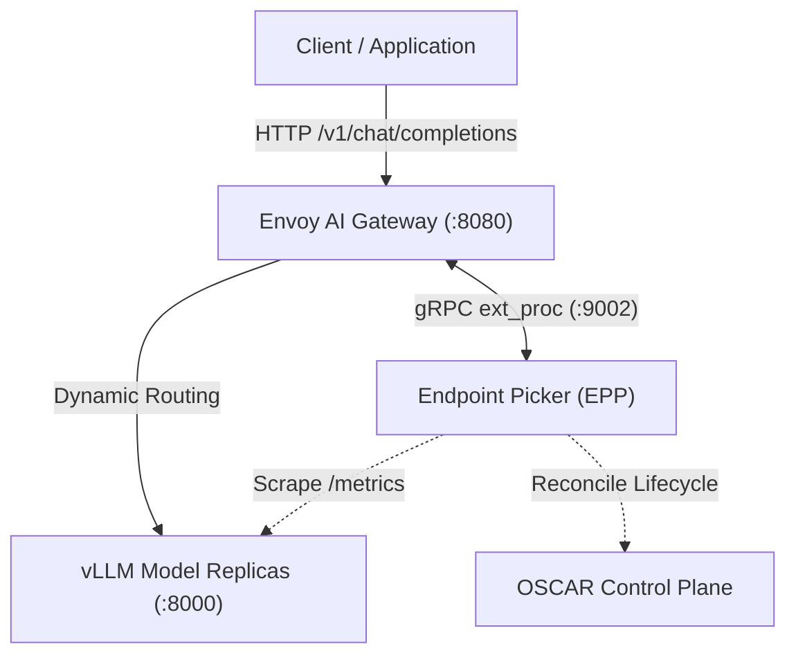

# OSCAR InferenceMesh

**OSCAR InferenceMesh** is an intelligent, low-latency AI Gateway and Endpoint Picker (EPP) architecture designed to integrate **OSCAR** serverless AI computing with **Envoy Gateway** and **Envoy AI Gateway**.

## Architecture Overview



- **Envoy AI Gateway**: Ingress proxy handling model routing, API schema validation, token tracking, and rate limiting.
- **EnvoyExtensionPolicy (`ext_proc`)**: Intercepts requests/responses via gRPC to route them dynamically to the best backend instance.
- **EPP (Endpoint Picker)**: Microservice that observes queue depths, model concurrency (via `/metrics`), and health status, scaling and selecting the optimal replica.
- **OSCAR**: Serverless computing control plane managing asynchronous workloads, warm pool provisioning, and autoscaling.

## Repository Layout

| Directory                                                              | Purpose                                                                                                                     |
| :--------------------------------------------------------------------- | :-------------------------------------------------------------------------------------------------------------------------- |
| [`deploy/`](file:///home/marc/Projects/oscar-inferencemesh/deploy)     | Declarative Kubernetes manifests for EPP (`deploy/epp`) and Envoy policies (`deploy/gateways`).                             |
| [`scripts/`](file:///home/marc/Projects/oscar-inferencemesh/scripts)   | Automation scripts for production deployment (`scripts/production`) and local development (`scripts/development`).          |
| [`src/`](file:///home/marc/Projects/oscar-inferencemesh/src)           | Go source code implementing `oscar-im` CLI, EPP gRPC daemon, Clean Architecture domain models, and infrastructure adapters. |
| [`examples/`](file:///home/marc/Projects/oscar-inferencemesh/examples) | Sample scripts and curl requests to test inference.                                                                         |

## Quick Start

### 1. Install Host Dependencies

```bash
./scripts/production/install-dependencies.sh
```

### 2. Initialize the Mesh

```bash
# Using the CLI
./src/bin/oscar-im init --docker
```

### 3. Verify Inference

```bash
./examples/requests/curl-inference.sh "¿Qué es la arquitectura hexagonal?"
```
