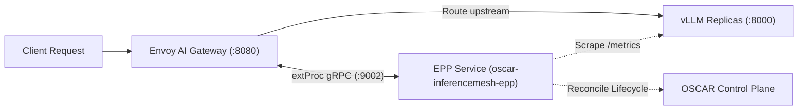

# Production & Deployment Automation (`scripts/production`)

This directory contains modular automation scripts for deploying, configuring, and managing the **Envoy AI Gateway**, the **Endpoint Picker (EPP)**, and **EnvoyExtensionPolicy (gRPC `ext_proc`)** across development and production environments.

## Scripts & Modules

| Script                                                                                                                       | Purpose                                                                                                                                                                                                                                            |
| :--------------------------------------------------------------------------------------------------------------------------- | :------------------------------------------------------------------------------------------------------------------------------------------------------------------------------------------------------------------------------------------------- |
| [`install-dependencies.sh`](file:///home/marc/Projects/oscar-inferencemesh/scripts/production/install-dependencies.sh)       | Installs all host runtime dependencies (`kubectl`, `helm`, `envsubst`, `curl`, `ca-certificates`, and optionally `docker`/`kind`) across apt, pacman, dnf, and zypper. Supports `--check-only` diagnostic mode.                                    |
| [`deploy-gateway.sh`](file:///home/marc/Projects/oscar-inferencemesh/scripts/production/deploy-gateway.sh)                   | Idempotently provisions Envoy Gateway (`v1.9.3`) and Envoy AI Gateway (`v1.2.0`) via Helm charts with `enableBackend=true` and `enableEnvoyPatchPolicy=true`. Supports `--uninstall` / `--clean`.                                                  |
| [`deploy-extension-policy.sh`](file:///home/marc/Projects/oscar-inferencemesh/scripts/production/deploy-extension-policy.sh) | Configures the `EnvoyExtensionPolicy` (`extProc` filter) linking `envoy-ai-gateway` to the EPP gRPC service on port `9002`. Supports `--force` and `--delete` / `--clean`.                                                                         |
| [`deploy-epp.sh`](file:///home/marc/Projects/oscar-inferencemesh/scripts/production/deploy-epp.sh)                           | Multi-stage Docker build of `oscar-inferencemesh-epp:latest`, local Kind loading (if applicable), and declarative Kubernetes rollout (`Deployment`, `Service`, RBAC) in `oscar-svc`. Supports `--force`, `--no-build`, and `--delete` / `--clean`. |

## Architecture & Flow



## Usage Examples

### 1. Provision Platform Gateways

```bash
./scripts/production/deploy-gateway.sh
```

### 2. Build & Deploy EPP Container in Kubernetes

```bash
export NAMESPACE="oscar-svc"
export MODEL_NAME="qwen2-5-05b-instruct"
./scripts/production/deploy-epp.sh
```

### 3. Attach EnvoyExtensionPolicy (gRPC)

```bash
./scripts/production/deploy-extension-policy.sh
```

### 4. Teardown / Clean All

```bash
./scripts/production/deploy-extension-policy.sh --clean
./scripts/production/deploy-epp.sh --clean
./scripts/production/deploy-gateway.sh --clean
```
