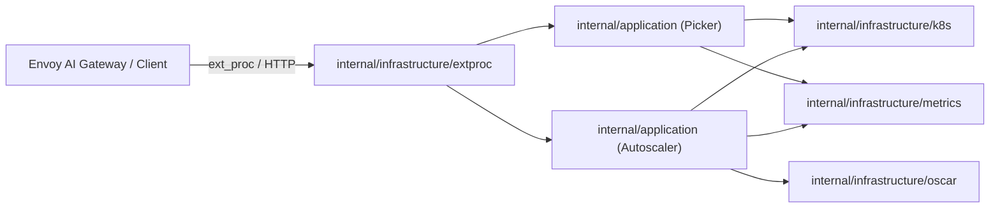

# Source Code (`src`)

This directory contains the Go module (`github.com/grycap/oscar-inferencemesh/src`) implementing the custom **Endpoint Picker (EPP)** and **OSCAR Elastic Autoscaler** for `oscar-inferencemesh`.

It is organized using **Clean / Hexagonal Architecture (Ports and Adapters)** so that domain models, routing policies, and autoscaling orchestrators remain decoupled from external protocols (Envoy `ext_proc`, Kubernetes Pod discovery, vLLM Prometheus `/metrics` scraping, and the OSCAR Control Plane).

## Architecture Overview



## Files & Subdirectories

| Path                                                                                                     | Type      | Description                                                                                                                |
| :------------------------------------------------------------------------------------------------------- | :-------- | :------------------------------------------------------------------------------------------------------------------------- |
| [`go.mod`](file:///home/marc/Projects/oscar-inferencemesh/src/go.mod)                                    | Go Module | Go module definition (`github.com/grycap/oscar-inferencemesh/src`).                                                        |
| [`cmd/inferencemesh/`](file:///home/marc/Projects/oscar-inferencemesh/src/cmd/inferencemesh)             | Directory | Main `inferencemesh` CLI entrypoint (`init` command for Gateway, EPP, and Patrón B ext_proc).                              |
| [`cmd/epp/`](file:///home/marc/Projects/oscar-inferencemesh/src/cmd/epp)                                 | Directory | Direct EPP service binary (`main.go`) serving gRPC ext_proc (`:9002`) and HTTP verification (`:9091`).                     |
| [`internal/config/`](file:///home/marc/Projects/oscar-inferencemesh/src/internal/config)                 | Directory | Environment-backed runtime configuration (`Settings`).                                                                     |
| [`internal/domain/`](file:///home/marc/Projects/oscar-inferencemesh/src/internal/domain)                 | Directory | Pure domain entities (`WorkerEndpoint`, `EndpointMetrics`, `RoutingDecision`, `ScalingDecision`) and port interfaces.      |
| [`internal/application/`](file:///home/marc/Projects/oscar-inferencemesh/src/internal/application)       | Directory | Use-case orchestrators (`EndpointPickerService`, `PassThroughSelector`, `AutoscalerOrchestrator`, `NoOpAutoscalerPolicy`). |
| [`internal/infrastructure/`](file:///home/marc/Projects/oscar-inferencemesh/src/internal/infrastructure) | Directory | Concrete adapters for Kubernetes discovery, vLLM Prometheus scraping, OSCAR CLI/REST control plane, and HTTP/ext_proc.     |

## Quick Verification & Usage

```bash
cd src

# 1. Run unit tests
go test ./... -v

# 2. Execute a one-shot self-check against the live Kubernetes & OSCAR cluster
go run ./cmd/epp --self-check

# 3. Start the HTTP verification & pass-through simulation server (default :9091)
go run ./cmd/epp --port 9091
```
